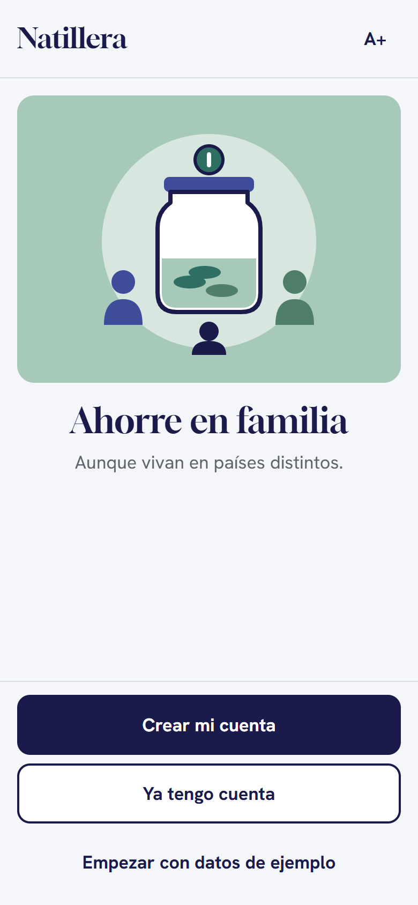
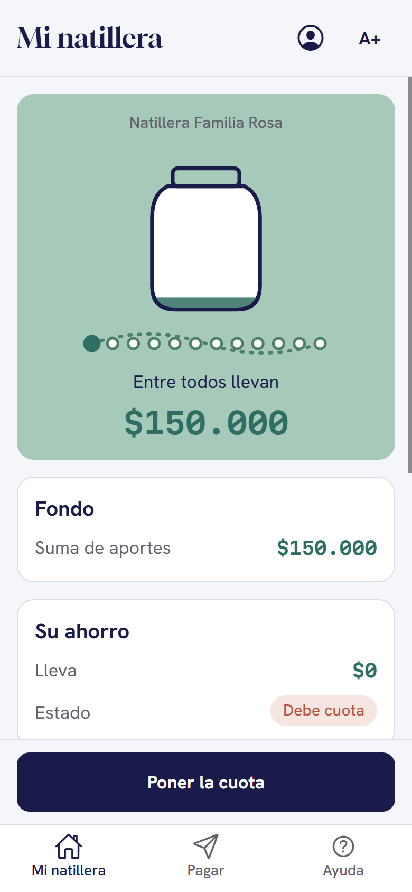
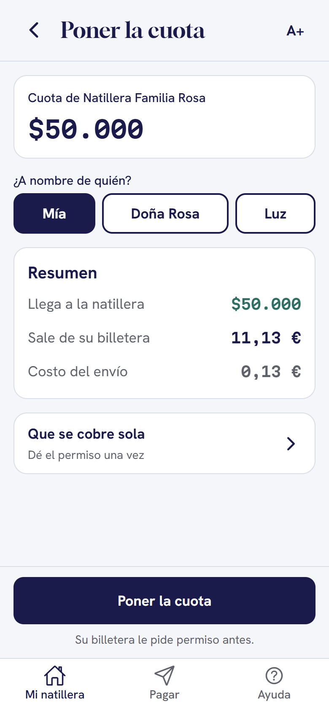
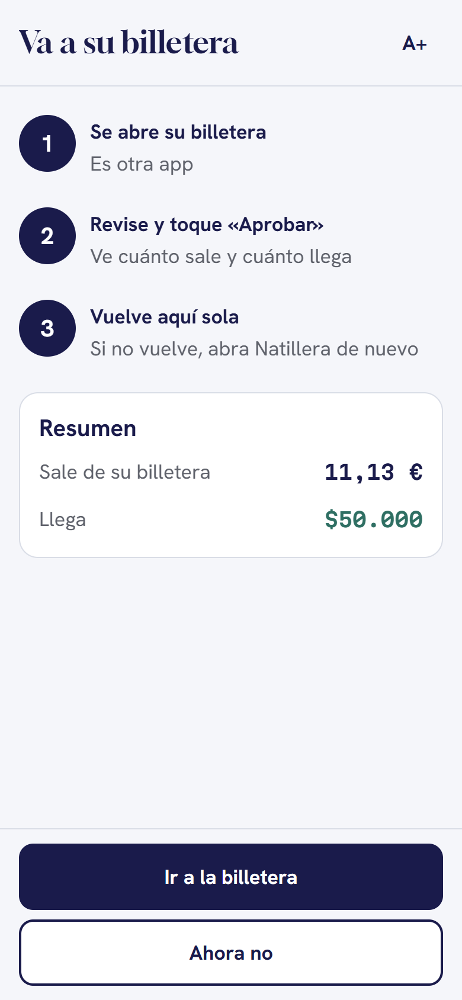
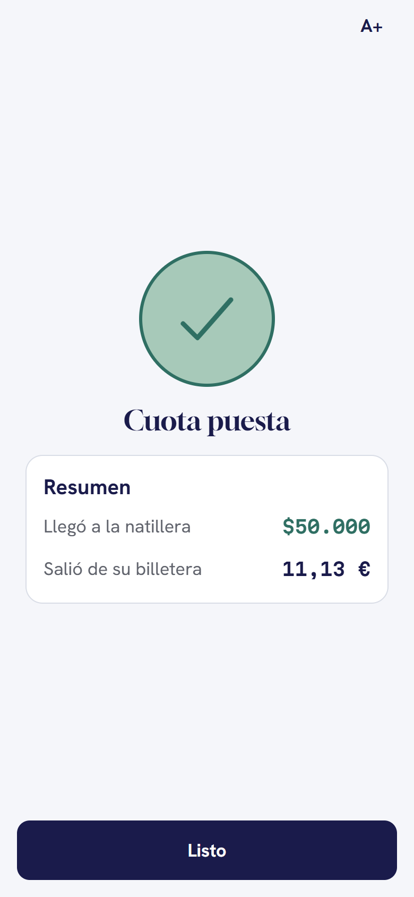

# Natillera sin Fronteras — app móvil

> **EN:** A family savings circle ("natillera") whose members live in different countries. Each member pays
> the shared fund in their own currency with **Open Payments**. The fund can also lend to its members.
> Built for the Interledger Open Payments Hackathon (Ruta N, Medellín, Oct 16–17, 2026).
> Backend: [interterledger-natillera-sin-fronteras-backend](https://github.com/duvanjaramillomarin/interterledger-natillera-sin-fronteras-backend).

Una **natillera** es un fondo de ahorro en familia: cada periodo todos ponen una cuota en una billetera común,
y el fondo les presta cuando lo necesitan. En muchas familias colombianas sus integrantes viven en países
distintos, y juntar la plata implica remesas, conversiones y alguien que lleve las cuentas a mano.

**Natillera sin Fronteras** junta la cuota de cada persona en su propia moneda (pesos, dólares o euros)
directamente en la billetera del fondo, con **Open Payments** de Interledger. La app está pensada para familias
con adultos mayores: textos cortos en «usted», botones grandes y un botón **A+** para agrandar la letra.

| Bienvenida | Mi natillera | Poner la cuota | Va a su billetera | Cuota puesta |
|---|---|---|---|---|
|  |  |  |  |  |

## Cómo usa Open Payments

**La app nunca firma ni guarda llaves.** El SDK de Open Payments corre solo en el backend (AWS Lambda), y la
app únicamente abre la página de aprobación de la billetera.

```
App ──POST /payments──▶ Backend: incoming payment (fondo) + quote + grant interactivo
App ◀── redirectUrl ───┘
App ──abre la billetera (Test Wallet)──▶ la persona aprueba
Billetera ──▶ Backend GET /payments/{id}/return: verifica el hash, continúa el grant y crea el outgoing payment
Backend ──302──▶ natillera://retorno?paymentId=…&result=…
App ──GET /payments/{id}──▶ estado final (pantalla 30 → resultado)
```

- Los montos viajan como `{ value: string, assetCode, assetScale }` en unidades menores. La app nunca usa floats para dinero.
- La quote muestra lo que sale de la billetera de quien paga y lo que llega al fondo, cada uno en su moneda (pantalla 28).
- Un pago solo se da por hecho cuando el backend lo confirma: la app consulta el estado real en vez de fiarse de la URL de vuelta.

## Qué funciona contra el backend real y qué es demo

| Real (Cognito + API Gateway + Lambda + Test Wallet) | Demo (datos de ejemplo) |
|---|---|
| Registro y entrada (Cognito), perfil | Préstamos 16–25 (el backend tiene la fase 1, sin desembolso) |
| Crear natillera, invitar con código y unirse | Aporte mensual automático (grant recurrente) |
| Cuentas guardadas | Metas de la familia (solo en la app) |
| Pagar a una persona y poner la cuota, con aprobación en la Test Wallet | |

La app funciona en **modo híbrido**: cada función pasa a real cuando su ruta existe en el backend
(`EXPO_PUBLIC_REAL_METHODS`), y el resto sigue con los datos de ejemplo. El botón «Empezar con datos de ejemplo»
abre la app completa en demo, sin internet (Doña Rosa, Luz y Andrés).

## Correrla

Requisitos: Node 22+ y [Expo Go](https://expo.dev/go) en el celular (o un emulador de Android).

```bash
npm install
cp .env.example .env      # valores públicos: URL del API, App Client de Cognito, IdToken
npx expo start            # escanear el QR con Expo Go; "w" para abrirla en el navegador
```

- **Solo demo:** `EXPO_PUBLIC_USE_MOCKS=1` en `.env`, o el botón «Empezar con datos de ejemplo».
- **APK (Android):** `npx eas-cli build -p android --profile preview`. `eas.json` ya trae las variables del API.
- **Pruebas:** `npm test` (15 casos: cuota, pagos, préstamos, modo híbrido, seguridad de la vuelta de la billetera, teléfono) y `npm run typecheck`.

## Stack

Expo SDK 58 + Expo Router · React Native 0.88 · TypeScript estricto · TanStack Query ·
Cognito directo por `fetch` (sin Amplify) con tokens en `expo-secure-store` · `expo-web-browser`
(`openAuthSessionAsync`) para la billetera · tipografías Gloock, Hanken Grotesk y Martian Mono.

```
src/
  app/          rutas (Expo Router): (auth) 01–03, (tabs) natillera/pagar/ayuda, billetera 28/30, resultado
  api/          client.ts (interfaz) · httpApi.ts (AWS) · mockApi.ts (demo) · hybridApi.ts · auth.ts (Cognito)
  features/     natillera, pagos, creditos, metas, telefono, navegacion
  components/   Screen, Button, Card, ResultScreen…  (áreas táctiles ≥ 48 px, contraste AA)
  theme/        Paleta G, tipografías y escala de texto (A+)
tests/          pruebas con node:test (sin red)
docs/           plan, contrato con el backend (openapi.yaml), pantallas, pitch
```

## Seguridad

- No hay secretos en el repo: `.env*` está ignorado y `.env.example` solo trae valores públicos.
- La URL de la billetera se acepta solo si es `https` de `*.interledger-test.dev`, y la vuelta solo se procesa si el pago lo inició esta sesión.
- El backend valida el `returnUrl` contra una lista cerrada y verifica el hash de la interacción.
- Auditoría y pruebas del 16/10: [docs/auditoria-2026-10-16.md](docs/auditoria-2026-10-16.md) · [docs/pruebas-2026-10-16.md](docs/pruebas-2026-10-16.md).

## Documentos

[Plan](docs/PLAN.md) · [Contrato del API (OpenAPI)](docs/openapi.yaml) · [Las 35 pantallas](docs/figma-pantallas.md) ·
[Resumen de Open Payments](docs/open-payments.md) · [Coordinación con el backend](docs/COORDINACION-BACK.md) ·
[Guion del pitch](docs/pitch/GUION.md) · [Figma](https://www.figma.com/design/hK29vkj23AZZXEN7W2hjmA)

## Uso de IA

Usamos IA (Claude Code) para construir buena parte del código y la documentación, siempre con revisión humana.
Qué herramienta se usó, para qué y en qué archivos está en [AI_USAGE.md](AI_USAGE.md); los prompts literales están
en [`/prompts`](prompts/), según la [política de IA de la hackatón](https://interledger.org/hackathon/ai-policy/).

## Equipo

- **App:** Henry Taborda y Camilo (Galactic AIMA).
- **Backend:** Duvan Jaramillo y David Ciro.
