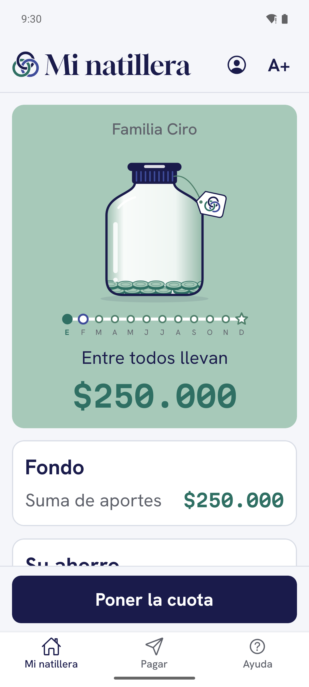
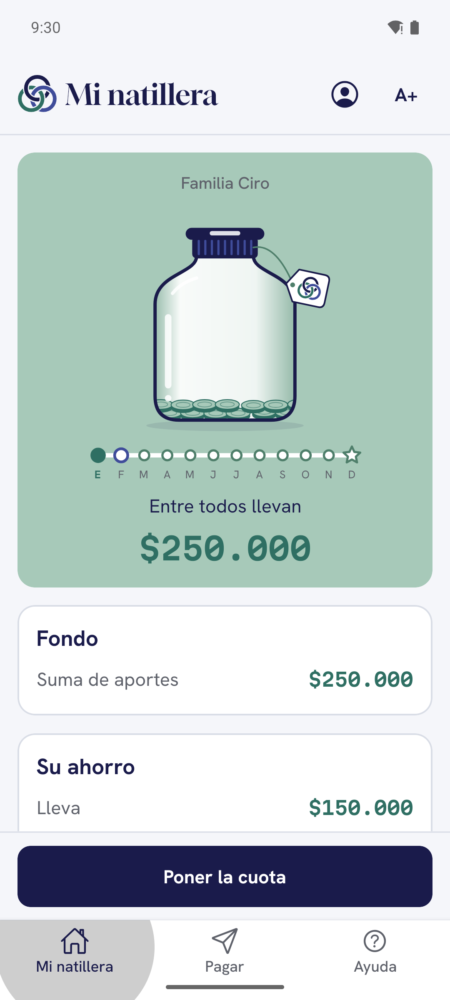
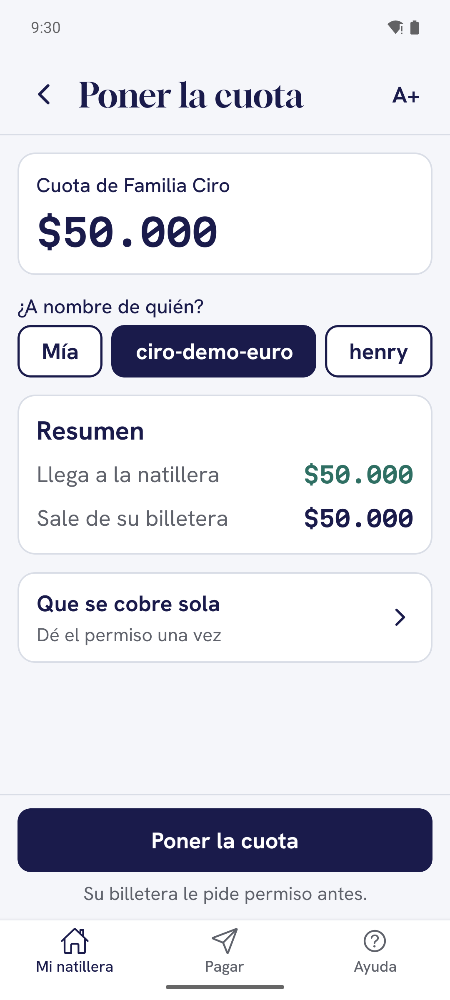
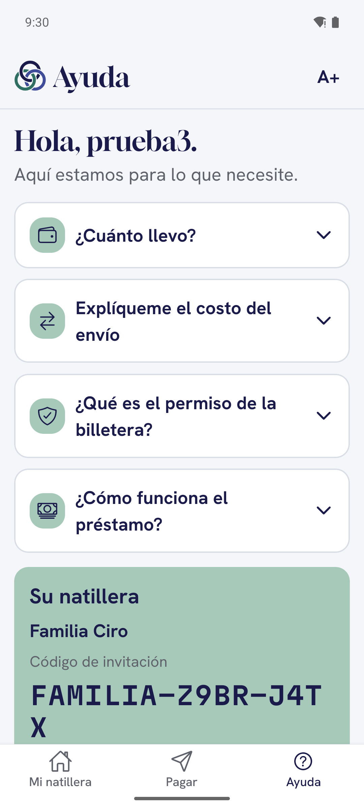

# Manual de usuario — Natillera sin Fronteras

La natillera de su familia, en el celular. Cada persona pone su cuota desde donde viva, en su propia moneda, y la
plata llega a la billetera común del fondo. El fondo también les presta.

> **Lo más importante:** la app **nunca mueve su plata sola**. Cada pago lo aprueba usted en su billetera. Si toca
> «Rechazar», no sale nada.

---

## Antes de empezar

Necesita:

1. **El celular** con la app Natillera instalada.
2. **Una billetera** de Interledger. En esta versión de prueba es la **Test Wallet**
   (`wallet.interledger-test.dev`). Su dirección se ve así: `https://ilp.interledger-test.dev/su-nombre`.
3. **Un correo** y **un número de celular**.

¿La letra se ve pequeña? Toque **A+** arriba a la derecha, en cualquier pantalla. Cada toque la agranda un poco más;
después del tamaño más grande vuelve al normal.

---

## 1. Crear su cuenta

1. Abra la app y toque **Crear mi cuenta**.
2. Escriba su **usuario**, su **correo**, su **celular** y una **contraseña** (mínimo 8 caracteres, con mayúscula,
   minúscula, número y símbolo, por ejemplo `!` o `#`).
3. Escriba la **dirección de su billetera** y espere a que la app la verifique.
4. Toque **Crear mi cuenta**. Entra de una vez.

¿Solo quiere conocer la app? Toque **Empezar con datos de ejemplo**: verá la natillera de Doña Rosa sin mover plata
de verdad.

## 2. Entrar

1. Toque **Ya tengo cuenta**.
2. Escriba su **usuario** y su **contraseña** y toque **Entrar**.

**¿Olvidó su contraseña?** Toque ese enlace, escriba su usuario y toque **Enviar código**. Le llega un código de
6 números al correo. Escríbalo, ponga la contraseña nueva dos veces y toque **Cambiar contraseña**.

## 3. Crear una natillera (si usted es la tesorera)

1. En **Mi natillera**, toque **Crear una**.
2. Escriba el **nombre** (por ejemplo «Familia Gómez»), elija en qué moneda **ahorra** la natillera y escriba la
   **dirección de la billetera del fondo**.
3. Toque **Crear la natillera**.
4. La app le muestra el **código de invitación**. Toque **Compartir** para mandarlo por WhatsApp a su familia.

Usted queda como **tesorera**: es quien aprueba los préstamos.

## 4. Unirse a la natillera de su familia

1. Pida el código a la tesorera. Se ve así: `PALABRA-XXXX-XXXX`.
2. En **Mi natillera**, toque **Unirme con un código**.
3. Escriba el código y toque **Buscar invitación**.
4. Revise el nombre de la natillera y la cuota, y toque **Unirme**.

Puede estar en varias natilleras. Cambie de una a otra en **Sus natilleras**, arriba en Mi natillera.

## 5. Poner la cuota

1. En **Mi natillera**, toque **Poner la cuota**.
2. En **¿A nombre de quién?** deje «Mía», o elija a otra persona si va a poner la cuota por ella.
3. Revise el **resumen**:
   - **Sale de su billetera**: lo que se descuenta, en su moneda.
   - **Llega a la natillera**: la cuota exacta, en la moneda del fondo.
   - **Costo del envío**.
4. Toque **Poner la cuota**. La app le explica lo que va a pasar y le dice **con qué billetera entrar**.
5. Toque **Ir a la billetera**. Se abre la Test Wallet.
6. Revise el monto y toque **Accept** (Aprobar) **una sola vez**.
7. Aparece «Su pago va en camino». La app se abre sola; si no, toque **Volver a la app**.
8. Espere unos segundos: la app confirma con el fondo y muestra **Cuota puesta**.

| Poner la cuota | Va a su billetera | Cuota puesta |
|---|---|---|
|  |  |  |

Para ver quién ya puso este mes: **Mi natillera → ¿Quién pone?**

## 6. Que la cuota se cobre sola (cuota automática)

Da un permiso **una sola vez** y la natillera cobra la cuota cada mes, sin que usted se acuerde.

1. En **Poner la cuota**, toque **Que se cobre sola**.
2. Revise **cuánto se cobra**, **cada cuánto**, **cuántas veces se repite** y **lo máximo por cobro** (la cuota más
   un pequeño margen por si cambia la tasa).
3. Toque **Activar la cuota automática** y apruebe el permiso en su billetera.
4. Vuelva a la app: verá **Cuota automática activada**.

Nunca se cobra más de lo máximo que usted aprobó.

## 7. Pagarle a una persona

1. Vaya a la pestaña **Pagar**.
2. En **¿A quién?** elija una cuenta guardada, o toque **+ Cuenta nueva** para guardar la billetera de alguien
   (dirección, **Verificar la billetera** y un nombre para reconocerla).
3. En **¿Cuánto le llega?** escriba lo que debe recibir la otra persona, en **su** moneda.
4. Espere un segundo: la app muestra cuánto sale de su billetera.
5. Toque **Pagar**, apruebe en su billetera y vuelva a la app.

Si la billetera de quien recibe no existe, la app se lo dice antes de pagar.

## 8. Pedir un préstamo al fondo

1. En **Mi natillera**, toque **Préstamos**.
2. Escriba **cuánto necesita** y elija **en cuántas cuotas** lo devuelve (de 1 a 12). La app le muestra cuánto le
   llega y cuánto paga en cada cuota.
3. Toque **Pedir el préstamo**.
4. Toque **Autorizar las cuotas** y apruebe en su billetera. Es el permiso para cobrar las cuotas del préstamo.
   **Sin este paso la tesorera no puede aprobarlo.**
5. Espere a la tesorera. Su préstamo dice **Esperando a la tesorera**.
6. Cuando ella aprueba, la plata le llega a su billetera, en su moneda. En **Ver el plan de pagos** ve cada cuota y
   cuánto le falta.

Si el fondo todavía no tiene esa plata, la app le pide un monto menor.

## 9. Aprobar préstamos (solo la tesorera)

1. En **Préstamos** verá las solicitudes de la familia.
2. Revise el **monto**, las **cuotas** y si ya están **Cuotas autorizadas**.
3. Toque **Aprobar** y apruebe el envío en **la billetera del fondo**. La plata sale del fondo a la billetera de quien
   pidió.
4. O toque **Rechazar**: no sale plata y el permiso de las cuotas queda sin efecto.

## 10. Metas de la familia

Para ahorrar juntos para algo puntual.

- **Ahorro:** apartan plata del fondo hasta llegar a un monto. Ejemplo: el viaje de diciembre.
- **Colecta:** cada quien aporta desde su billetera, en su moneda, y la plata le llega **directo** a quien la
  necesita. Ejemplo: la cirugía de la abuela.

1. En **Mi natillera**, en **Metas de la familia**, toque **Nueva meta**.
2. Elija el tipo, escriba **para qué es**, **cuánto** y **para cuándo**. En una colecta, escriba a quién le llega y
   verifique su billetera.
3. Toque **Crear la meta**. En la meta, **¿Cuánto le toca?** dice cuánto pone cada uno.

> **Por ahora las metas se guardan solo en su celular** y se borran al cerrar la app. Los aportes a una colecta sí
> son pagos de verdad.

## 11. Ayuda y su cuenta

- **Ayuda** (pestaña de abajo): cuánto lleva ahorrado, qué es el costo del envío, qué es el permiso de la billetera,
  cómo funciona el préstamo y el código de su natillera para compartirlo.
- **Su cuenta** (botón arriba en Mi natillera): sus datos, su billetera y **Cerrar sesión**.

---

## Si algo no sale bien

| Lo que ve | Qué hacer |
|---|---|
| La Test Wallet dice **«Access to the given resource is forbidden»** | En la billetera está abierta otra cuenta. Cierre esa sesión y entre con la cuenta **dueña de la billetera que paga** (la pantalla anterior le dice cuál) |
| La Test Wallet dice **«Internal Server Error»** | Casi siempre es por tocar Accept dos veces. **El pago ya salió.** Cierre la pestaña: la app muestra el resultado |
| Se quedó en la billetera y no volvió | Toque **Volver a la app**, o cierre la pestaña. La app revisa el pago sola |
| «No dio el permiso» | Tocó Rechazar o cerró la billetera antes de aprobar. **No salió plata.** Puede intentarlo de nuevo |
| «Todavía no está lista en el servidor» | Esa función aún no está disponible. **No salió plata** |
| No le llega el código para la contraseña | Revise el correo no deseado y toque **No me llegó el código** |
| No ve bien la letra | Toque **A+** |

¿Dudas? Pregúntele a la tesorera de su natillera o escríbanos por el repositorio del proyecto.
